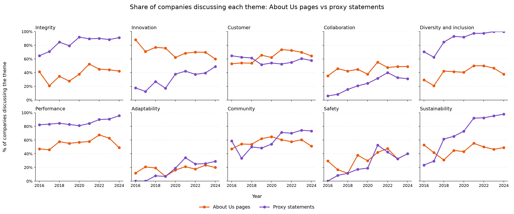
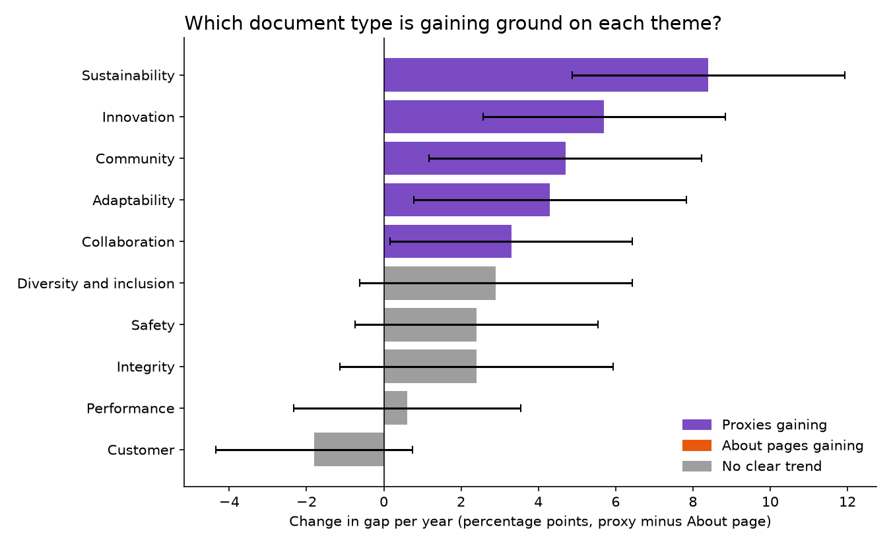

## What I did

I compared how often companies discuss each of the 10 themes on their About Us pages (Part 1) and in their proxy statements (Part 2), year by year from 2016 to 2024.

1. **Comparison** (`theme_comparison.py`): for every company-year with both documents, I marked whether each one discusses each theme. An About page discusses a theme if Gemini identified it; a proxy discusses it if it appears in at least 1% of its sentences. This gives the share of companies discussing each theme in each document, every year (`data/final/theme_by_year.csv`, `theme_summary.csv`).
2. **Visualizations** (`plot_themes.py`): one chart per theme in `visualizations/`, plus `all_themes.png` with all 10 side by side.
3. **Gap analysis** (`gap_analysis.py`): measured how the gap between the two documents changed each year within the same companies, checked whether each trend is statistically clear, and repeated it with 0.5% and 2% thresholds and within each sector (`gap_trends.csv`, `gap_by_sector.csv`, `visualizations/gap_trends.png`).

## Visualizations

Orange lines are About Us pages and purple lines are proxy statements. Each theme's chart marks where the two lines cross or, if they never cross, each line's highest and lowest points.

- Sustainability: the two lines cross around 2018, after which proxies pull far ahead while About pages stay flat.
- Innovation: About pages start much higher, but proxies steadily close the gap.
- Diversity and inclusion: both lines rise, but About pages fall after 2022 while proxies keep climbing.
- Safety, community and adaptability: the two lines move closely together.
- Integrity and performance: proxies stay above About pages throughout, with a fairly constant gap.

This chart shows how fast the gap changed for each theme. Purple bars are themes where proxies gained ground with a statistically clear trend; grey bars show no clear change. Sustainability and innovation hold at every threshold; community, adaptability and collaboration depend on the threshold. By sector, the sustainability shift comes mainly from Consumer Discretionary and Healthcare, as Energy companies already discussed it in both.

Overall, proxies have taken on some themes, most clearly sustainability, while others moved in step. This helps explain the modest alignment in Part 3: the two documents evolve differently, theme by theme.

## Why

- Using the same measure for both documents, the share of companies discussing a theme, makes them directly comparable.
- Tracking the gap over time shows which themes are drifting apart and which move together.
- Measuring within the same companies and testing several thresholds separates real shifts from changes in the sample or the measurement choice.

## Assumptions

- A theme in at least 1% of a proxy's sentences is genuinely discussed, not mentioned in passing.
- Gemini's labels from Part 1 reflect whether an About page discusses a theme.
- A straight-line trend is a reasonable summary of each gap over nine years.

## What I would do differently with more time

- Link turning points, such as the drop in diversity language on websites, to specific events.
- Study the companies with the largest gaps to understand what drives them.
- Label proxies with Gemini as well, so both documents are measured the same way.

## Known limitations

- The two documents are measured differently, so trends over time are more reliable than the size of the gap in any year.
- Earlier years include fewer companies, so estimates before 2019 are less precise.
- Diversity keywords in proxies are broad (for example, board diversity), which pushes that line close to 100%.
- The results show patterns over time, not their causes.
